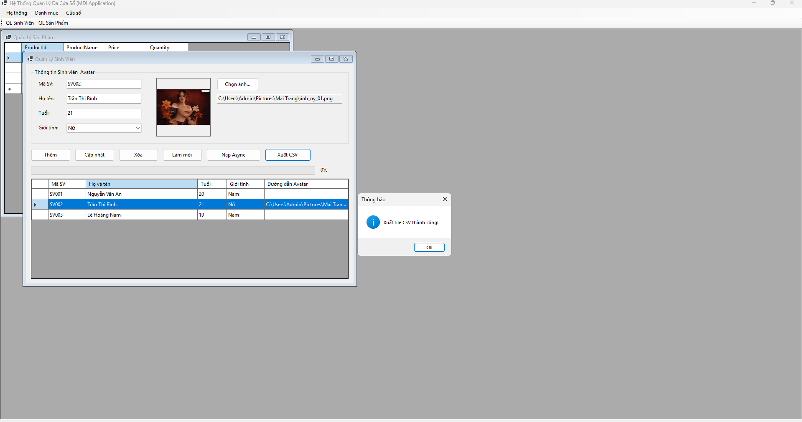
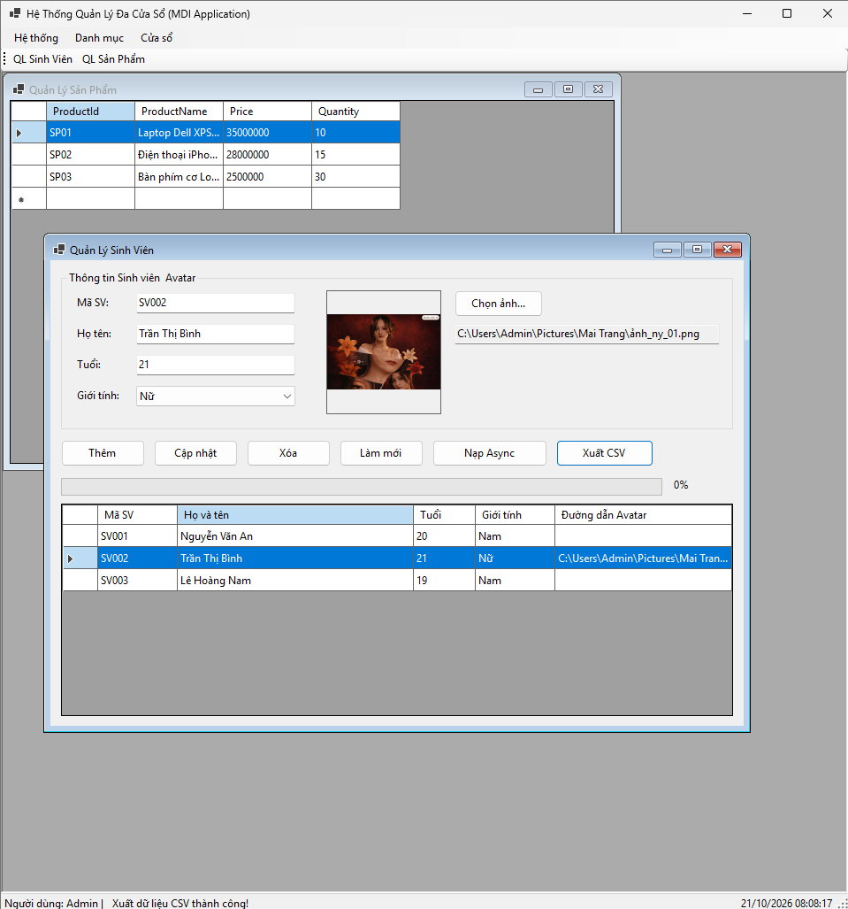
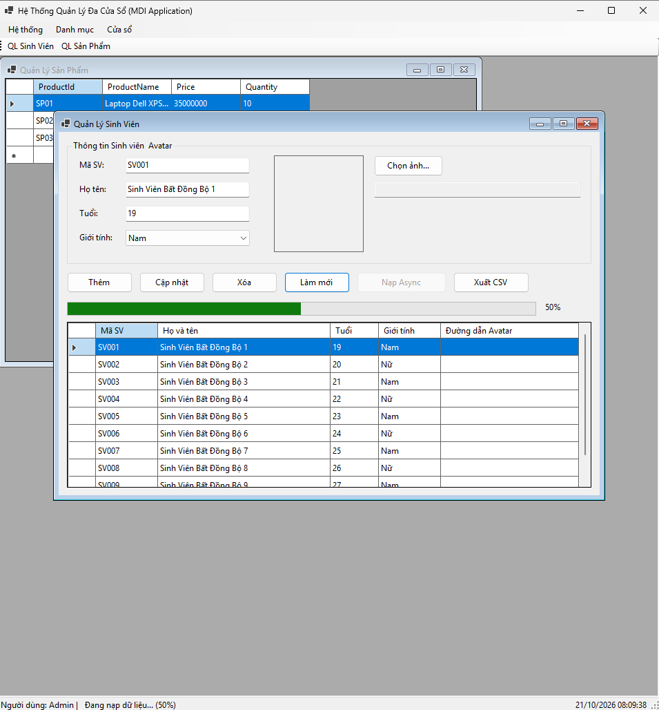

# BÁO CÁO BÀI TẬP LẬP TRÌNH C# - WINDOWS FORMS

## THÔNG TIN SINH VIÊN

- **Họ và tên:** Lại Thanh Long
- **Mã số sinh viên:** 24810310231
- **Lớp:** D19CNPM3
- **Tên môn học:** Lập trình C# / Windows Forms
- **Tên bài tập:** Ôn tập & Tổng hợp Windows Forms (Bài 4.6, 4.7, 4.8)

---

## KẾT QUẢ THỰC HÀNH CÁC BÀI TẬP

### 1. BÀI 4.6: Quản lý dữ liệu với BindingSource & Xử lý File (Avatar / CSV)

- Sử dụng `BindingSource` kết nối `BindingList<Student>` với `DataGridView` và các Control nhập liệu (2 chiều).
- Hiển thị ảnh đại diện Avatar thông qua `PictureBox` + `OpenFileDialog`.
- Hỗ trợ xuất danh sách sinh viên ra file CSV chuẩn UTF-8 bằng `SaveFileDialog`.

---

### 2. BÀI 4.7: Thiết kế khung ứng dụng MDI & Quản lý đa cửa sổ

- Cấu hình `FormMain` làm **MDI Parent** tích hợp `MenuStrip`, `ToolStrip`, `StatusStrip` và `Timer` đồng hồ.
- Quản lý mở Form con (`FormStudent`, `FormProduct`) thông qua hàm generic kiểm tra mở trùng lặp (`Activate` form nếu đã mở).
- Tích hợp `ContextMenuStrip` trên `DataGridView` và cơ chế truyền thông điệp cập nhật `StatusStrip` từ Form con lên Form cha.

---

### 3. BÀI 4.8: Lập trình bất đồng bộ (Async/Await) & Tiến trình ProgressBar

- Sử dụng `async/await` kết hợp `Task.Run` giả lập nạp dữ liệu ngầm mà không làm đơ/treo giao diện (UI).
- Cập nhật tiến trình thời gian thực (0% - 100%) lên thanh `ProgressBar` và `StatusStrip` bằng đối tượng `IProgress<int>`.
- Khóa nút bấm (`Enabled = false`) trong lúc tác vụ ngầm đang chạy để tránh kích hoạt trùng lặp.

